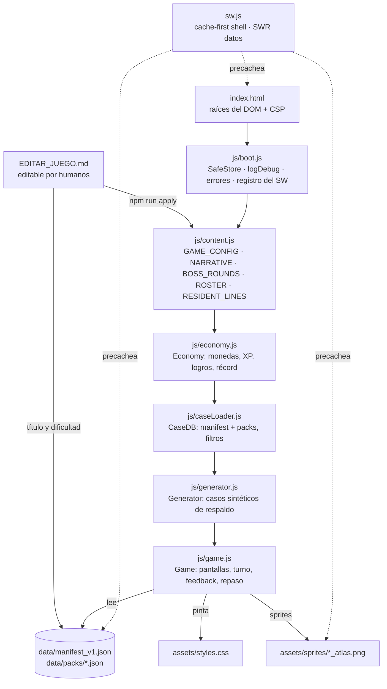
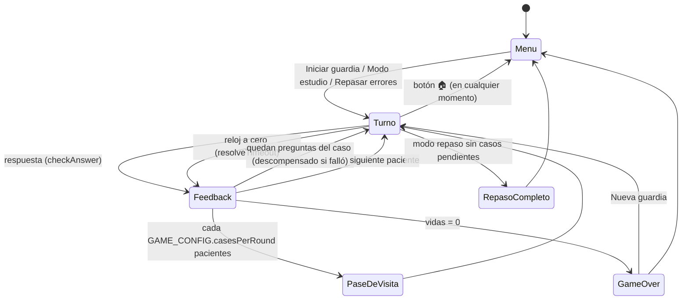

# Mapa de PsyCase

Este documento tiene dos mitades. La de arriba la escribe una persona y explica
**cómo está pensada** la app: qué pieza hace qué y por qué. La de abajo la
regenera `npm run map` leyendo el código, y dice **dónde está** cada cosa hoy.
Si las dos mitades se contradicen, manda el código, y la mitad manual necesita
una revisión (ver `docs/GUIA_REVISION.md`).

---

## 1. Qué es, en una frase

Una PWA sin dependencias ni build: HTML + CSS + cinco scripts clásicos que se
cargan en orden, un Service Worker para jugar offline y un banco de casos
clínicos en JSON. Abrir `index.html` desde un servidor estático basta.

## 2. Piezas y responsabilidades

| Módulo | Expone | Depende de | No debe |
|---|---|---|---|
| `boot.js` | `_esc`, `SafeStore`, `logDebug`, `PsyBoot` | nada | conocer la lógica del juego |
| `content.js` | `GAME_CONFIG`, `NARRATIVE`, `BOSS_ROUNDS`, `ROSTER`, `RESIDENT_LINES` | nada | editarse a mano: lo genera `tools/editDoc.js` desde `EDITAR_JUEGO.md` |
| `economy.js` | `Economy` | `localStorage` (clave `psy_miami_save_v2`) | tocar el DOM |
| `caseLoader.js` | `CaseDB.init/pickRandomCase/getPoolSize/hasCase/isReady` | `fetch` | decidir qué hacer si no hay casos |
| `generator.js` | `Generator.createCase(filters)` | nada | usarse si hay casos reales disponibles |
| `game.js` | `Game.init()` (nada más) | todo lo anterior | escribir en `localStorage` sin `SafeStore` |

`game.js` es un IIFE con un objeto `state` privado. Las tablas de diseño
(`GAME_CONFIG`, `NARRATIVE`, `BOSS_ROUNDS`, `ROSTER`, `RESIDENT_LINES`) viven en
`js/content.js`, generado desde `EDITAR_JUEGO.md`; en `game.js` quedan
`MOOD_FRAMES` y `Avatars`, que dependen de la geometría de los sprites.

### EDITAR_JUEGO.md ⇄ juego

`tools/editDoc.js` lee el documento por secciones (marcadas con
`<!-- sección: … -->`), valida cada valor con mensajes en castellano y la línea
exacta, y sólo si todo es correcto escribe `js/content.js`, sube
`CACHE_VERSION`, actualiza `display_title`/`difficulty` en
`data/cases_v1.json` y regenera packs + manifest. Después reescribe el
documento normalizado: las notas con sangría (respuesta esperada, aviso ⚠️ de
título-spoiler) se recalculan. Lo ejecutan el gancho de pre-commit y la acción
`.github/workflows/aplicar.yml` en cada push.

## 3. Raíces del DOM

| Raíz | Contiene | Quién la pinta |
|---|---|---|
| `#hudRoot` | El menú (fuera de partida) o el HUD (en partida) | `renderMenu()`, `renderHUD()` |
| `#caseRoot` | Tarjeta del caso, pregunta, firma y opciones | `renderCase()` |
| `#modalRoot` | Feedback, pase de visita, Game Over, repaso completado | `show*Feedback()`, `showRoundReview()`, `renderGameOver()` |
| `#fxRoot` | Efectos efímeros: destellos, monedas flotantes, banner de racha, logros | `flashScreen()`, `floatReward()`, `showComboBanner()`, `showAchievementToasts()` |
| `.urgency-fx` | Viñeta roja del reloj (sólo opacidad) | clases `hot-zone-active` / `time-critical` en `<body>` vía `setUrgency()` |

## 4. Flujo de pantallas

### Ciclo de una pregunta

1. `nextCase()` elige residente y caso (banco real → reintento sin exclusiones → generador sólo para ese turno).
2. `beginTask()` desbloquea ayudas (`state.locked = false`), calcula el reloj (`prepareTimer()`), pinta HUD y caso y arranca `startTimer()`.
3. El jugador responde → `checkAnswer()` bloquea (`state.locked = true`), puntúa, actualiza repaso y muestra `showSmartFeedback()` tras `modalDelayMs`.
   O se agota el reloj → `resolveTimeout()` hace lo mismo como fallo y muestra `showTimeoutFeedback()`.
4. `bindFeedbackControls()` gestiona "Siguiente" (una sola vez), "Ver explicación" y el auto-avance.
5. `advanceNext()` decide: otra pregunta del mismo caso, pase de visita, Game Over o siguiente paciente.

### Reglas que sostienen el flujo

- **`state.runId`**: cada guardia y cada vuelta al menú lo incrementan. Todo `setTimeout` que pinte algo usa `later()`, que se descarta si la sesión cambió. Sin esto, salir al menú justo tras responder dejaba un feedback flotando sobre el menú.
- **`state.locked`**: una sola decisión por pregunta y ninguna compra después de decidir.
- **`state.caseHadError`**: el repaso espaciado sólo asciende un caso resuelto entero sin fallos.
- **`PsyBoot.inShift`**: una versión nueva del SW no recarga la página a mitad de guardia; espera al menú.

## 5. Datos

- **Fuente editable:** `data/cases_v1.json`.
- **Lo que carga la app:** `data/manifest_v1.json` (índice plano con `case_id`, `pack`, `difficulty`, `educational_level`) + `data/packs/cases_real_v1.json`.
- **Contrato del manifest:** `tools/lib/manifest.js` (`assertLoadable()` reproduce lo que exige `caseLoader.js`).
- **Campos que el juego usa de un caso:** `case_id`, `display_title` (o `title`), `case_type`, `difficulty`, `educational_level`, `metadata.is_real_data`, `source_chunks[].text_content`, `tasks[]` (`instruction`/`question`, `expected_answer`, `distractors`, `rationale` opcional), `explanation` (`rationale`, `take_home`, `why_not[]`).
- `why_not` se filtra por pregunta: sólo se muestran las entradas cuyas `option` coinciden con los distractores de la pregunta en pantalla.

## 6. Persistencia

| Clave | Módulo | Contenido |
|---|---|---|
| `psy_miami_save_v2` | `economy.js` | monedas, XP, logros, récord, contadores de carrera |
| `psycase_failed_cases` | `game.js` | `[{caseId, level, nextReview}]` del repaso espaciado (0 → +24 h → +72 h → borrado) |
| `psy_pref_sound`, `psy_pref_autoadvance` | `game.js` | preferencias |

Todas pasan por `SafeStore` (o por `try/catch` en `economy.js`): sin almacenamiento la app se juega igual, sólo no recuerda.

## 7. Offline y actualizaciones

- `sw.js` precachea `APP_SHELL` en `install`. **Si una ruta de esa lista no existe, la instalación entera falla**: por eso `npm run check` lo verifica.
- App shell: cache-first; navegaciones ignoran la query y caen a `index.html` sin red.
- `/data/*` y Google Fonts: stale-while-revalidate.
- Cambiar código del runtime ⇒ subir `CACHE_VERSION`.

---

## 8. Estado actual (automático)

<!-- AUTO:START -->
> Bloque generado por `npm run map`. No lo edites a mano: se sobrescribe.

**Huella del runtime:** `e09ca31c6514` · **CACHE_VERSION:** `psycase-v1.8.1`

### Archivos del runtime

| Archivo | Líneas | KB |
|---|---|---|
| `index.html` | 75 | 3.5 |
| `sw.js` | 143 | 4.7 |
| `manifest.webmanifest` | 41 | 0.9 |
| `assets/styles.css` | 2477 | 58.5 |
| `js/boot.js` | 115 | 4.2 |
| `js/caseLoader.js` | 175 | 5.5 |
| `js/content.js` | 213 | 6.3 |
| `js/economy.js` | 165 | 6.0 |
| `js/game.js` | 2063 | 83.2 |
| `js/generator.js` | 751 | 58.7 |

### Índice de símbolos

Nivel superior y funciones internas de cada módulo, con su línea. Úsalo para saltar directo al código (`archivo:línea`).

<code>js/boot.js</code> · 5 símbolos

- `js/boot.js:12` `_esc()`
- `js/boot.js:18` `SafeStore`
- `js/boot.js:38` `_isLocal`
- `js/boot.js:40` `logDebug()`
- `js/boot.js:80` `PsyBoot`

<code>js/caseLoader.js</code> · 9 símbolos

- `js/caseLoader.js:7` `CaseDB`
- `js/caseLoader.js:8` ↳ `CONFIG`
- `js/caseLoader.js:19` ↳ `init()`
- `js/caseLoader.js:48` ↳ `loadPack()`
- `js/caseLoader.js:86` ↳ `isRealEntry()`
- `js/caseLoader.js:90` ↳ `filterPool()`
- `js/caseLoader.js:112` ↳ `pickRandomCase()`
- `js/caseLoader.js:153` ↳ `getPoolSize()`
- `js/caseLoader.js:160` ↳ `hasCase()`

<code>js/content.js</code> · 5 símbolos

- `js/content.js:8` `GAME_CONFIG`
- `js/content.js:32` `NARRATIVE`
- `js/content.js:43` `BOSS_ROUNDS`
- `js/content.js:98` `ROSTER`
- `js/content.js:149` `RESIDENT_LINES`

<code>js/economy.js</code> · 6 símbolos

- `js/economy.js:1` `Economy`
- `js/economy.js:2` ↳ `STORAGE_KEY`
- `js/economy.js:23` ↳ `num()`
- `js/economy.js:27` ↳ `load()`
- `js/economy.js:48` ↳ `save()`
- `js/economy.js:56` ↳ `ACHIEVEMENTS`

<code>js/game.js</code> · 80 símbolos

- `js/game.js:7` `_lineMemory`
- `js/game.js:8` `pickLine()`
- `js/game.js:19` `SPRITE_COLS`
- `js/game.js:20` `SPRITE_ROWS`
- `js/game.js:24` `MOOD_FRAMES`
- `js/game.js:37` `Avatars`
- `js/game.js:110` `Game`
- `js/game.js:166` ↳ `newShift()`
- `js/game.js:173` ↳ `later()`
- `js/game.js:178` ↳ `setUrgency()`
- `js/game.js:184` ↳ `stopTurnFx()`
- `js/game.js:191` ↳ `ScreenManager`
- `js/game.js:212` ↳ `escapeHtml()`
- `js/game.js:224` ↳ `FAILED_KEY`
- `js/game.js:225` ↳ `REVIEW_DELAYS_MS`
- `js/game.js:226` ↳ `MASTERY_LEVEL`
- `js/game.js:228` ↳ `getFailedCases()`
- `js/game.js:250` ↳ `storeFailedCases()`
- `js/game.js:254` ↳ `getDueFailedCases()`
- `js/game.js:262` ↳ `pruneFailedCases()`
- `js/game.js:269` ↳ `saveFailedCase()`
- `js/game.js:284` ↳ `promoteFailedCase()`
- `js/game.js:300` ↳ `SENTENCE_RE`
- `js/game.js:302` ↳ `getBriefFeedback()`
- `js/game.js:312` ↳ `getWhyNotForTask()`
- `js/game.js:319` ↳ `getExplanationPayload()`
- `js/game.js:336` ↳ `getCaseTitle()`
- `js/game.js:340` ↳ `normalizeCaseText()`
- `js/game.js:346` ↳ `getStreakMultiplier()`
- `js/game.js:351` ↳ `getMultiplierLabel()`
- `js/game.js:359` ↳ `isUntimed()`
- `js/game.js:365` ↳ `getSpeedInfo()`
- `js/game.js:375` ↳ `formatMultiplier()`
- `js/game.js:380` ↳ `pickResident()`
- `js/game.js:387` ↳ `getResidentPresentLine()`
- `js/game.js:397` ↳ `BOSS_STATES`
- `js/game.js:407` ↳ `getBossState()`
- `js/game.js:411` ↳ `getBossStatus()`
- `js/game.js:415` ↳ `splitCaseText()`
- `js/game.js:430` ↳ `withTransition()`
- `js/game.js:438` ↳ `flashScreen()`
- `js/game.js:450` ↳ `shakeScreen()`
- `js/game.js:462` ↳ `floatReward()`
- `js/game.js:473` ↳ `showComboBanner()`
- `js/game.js:486` ↳ `showAchievementToasts()`
- `js/game.js:508` ↳ `pushAchievements()`
- `js/game.js:512` ↳ `renderMenu()`
- `js/game.js:701` ↳ `renderGameOver()`
- `js/game.js:819` ↳ `showReviewSuccess()`
- `js/game.js:843` ↳ `ensureCasesLoaded()`
- `js/game.js:856` ↳ `startTurn()`
- `js/game.js:910` ↳ `renderHUD()`
- `js/game.js:1122` ↳ `useHint()`
- `js/game.js:1137` ↳ `buyLife()`
- `js/game.js:1144` ↳ `buyTime()`
- `js/game.js:1156` ↳ `pickTask()`
- `js/game.js:1174` ↳ `getPatientEcgClass()`
- `js/game.js:1196` ↳ `renderCase()`
- `js/game.js:1331` ↳ `toggleSign()`
- `js/game.js:1348` ↳ `beginTask()`
- `js/game.js:1368` ↳ `prepareTimer()`
- `js/game.js:1375` ↳ `startTimer()`
- `js/game.js:1435` ↳ `resolveTimeout()`
- `js/game.js:1472` ↳ `hasMoreTasks()`
- `js/game.js:1478` ↳ `recordMistake()`
- `js/game.js:1488` ↳ `nextCase()`
- `js/game.js:1555` ↳ `advanceNext()`
- `js/game.js:1579` ↳ `showRoundReview()`
- `js/game.js:1658` ↳ `bindFeedbackControls()`
- `js/game.js:1705` ↳ `renderExpandedFeedback()`
- `js/game.js:1723` ↳ `showSmartFeedback()`
- `js/game.js:1800` ↳ `consequenceHtml()`
- `js/game.js:1812` ↳ `nextLabel()`
- `js/game.js:1819` ↳ `showTimeoutFeedback()`
- `js/game.js:1854` ↳ `handleDeath()`
- `js/game.js:1861` ↳ `checkAnswer()`
- `js/game.js:1980` ↳ `init()`
- `js/game.js:2019` ↳ `playSequence()`
- `js/game.js:2025` ↳ `ensureAudio()`
- `js/game.js:2039` ↳ `playTone()`

<code>js/generator.js</code> · 9 símbolos

- `js/generator.js:14` `Generator`
- `js/generator.js:15` ↳ `NAMES`
- `js/generator.js:16` ↳ `LAST_NAMES`
- `js/generator.js:18` ↳ `AGES`
- `js/generator.js:19` ↳ `CONTEXTS`
- `js/generator.js:28` ↳ `SYMPTOM_MODULES`
- `js/generator.js:687` ↳ `getRandom()`
- `js/generator.js:689` ↳ `shuffle()`
- `js/generator.js:698` ↳ `createCase()`

### Caché offline (APP_SHELL de `sw.js`)

`./` · `./index.html` · `./manifest.webmanifest` · `./assets/styles.css` · `./js/boot.js` · `./js/content.js` · `./js/economy.js` · `./js/caseLoader.js` · `./js/generator.js` · `./js/game.js` · `./assets/icons/icon-192.png` · `./assets/icons/icon-512.png` · `./data/manifest_v1.json` · `./data/packs/cases_real_v1.json` · `./assets/sprites/aguilar_atlas.png` · `./assets/sprites/castaneda_atlas.png` · `./assets/sprites/celada_atlas.png` · `./assets/sprites/ferrer_atlas.png` · `./assets/sprites/herrera_atlas.png` · `./assets/sprites/mendoza_atlas.png` · `./assets/sprites/rios_atlas.png` · `./assets/sprites/solis_atlas.png` · `./assets/sprites/valdez_atlas.png` · `./assets/sprites/pac1_atlas.png` · `./assets/sprites/pac2_atlas.png` · `./assets/sprites/pac3_atlas.png`

### Claves de almacenamiento local

`psy_miami_save_v2` · `psy_pref_autoadvance` · `psy_pref_sound` · `psycase_failed_cases`

### Banco de casos

95 casos en `data/packs/cases_real_v1.json` · 17 con varias preguntas · 112 preguntas en total.

| Nivel · dificultad | Casos |
|---|---|
| especialidad · media | 5 |
| licenciatura · dificil | 2 |
| licenciatura · facil | 28 |
| licenciatura · media | 60 |

| Prefijo de case_id | Casos |
|---|---|
| `CLIN_` | 20 |
| `EDU_` | 17 |
| `HOSP_` | 21 |
| `NEW_` | 8 |
| `REAL_` | 29 |

Deuda editorial medida automáticamente:

- Casos sin `display_title` neutro: **28**
- Preguntas con `rationale` propio: **0/112** (el resto usa el del caso)
- Casos `documento_educativo`: **0** (el código los soporta: sin reloj, ECG plano)

### Coherencia

- ✅ APP_SHELL, scripts de index.html, sprites y manifest coherentes.
- ✅ Sin clases CSS huérfanas detectables.
<!-- AUTO:END -->
