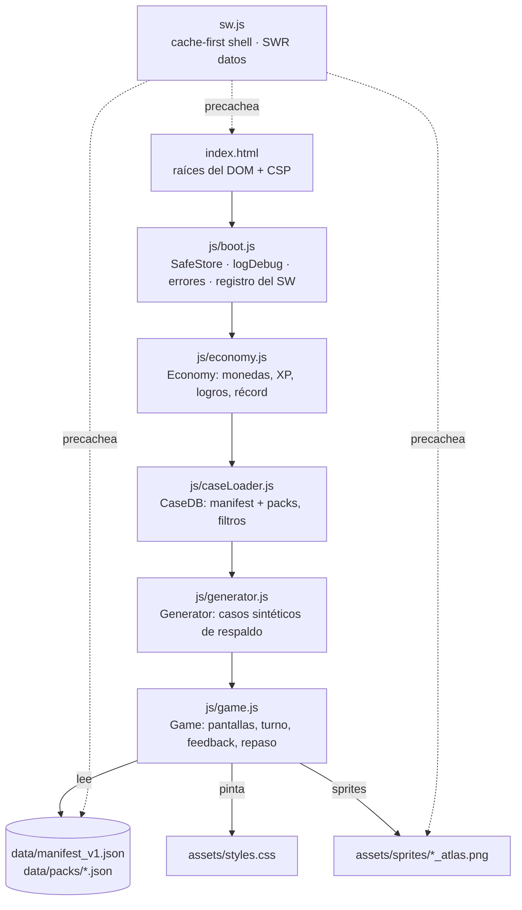
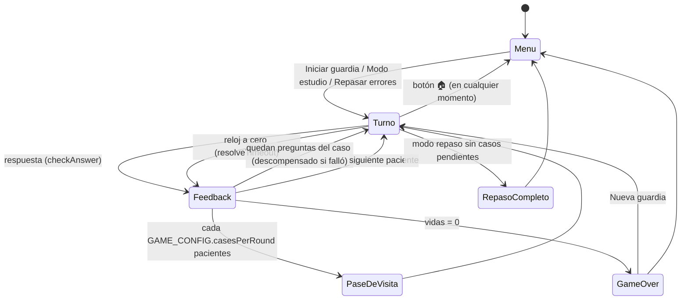

# Mapa de PsyCase

Este documento tiene dos mitades. La de arriba la escribe una persona y explica
**cómo está pensada** la app: qué pieza hace qué y por qué. La de abajo la
regenera `npm run map` leyendo el código, y dice **dónde está** cada cosa hoy.
Si las dos mitades se contradicen, manda el código, y la mitad manual necesita
una revisión (ver `docs/GUIA_REVISION.md`).

---

## 1. Qué es, en una frase

Una PWA sin dependencias ni build: HTML + CSS + cinco scripts clásicos que se
cargan en orden, un Service Worker para jugar offline y un banco de casos
clínicos en JSON. Abrir `index.html` desde un servidor estático basta.

## 2. Piezas y responsabilidades

| Módulo | Expone | Depende de | No debe |
|---|---|---|---|
| `boot.js` | `_esc`, `SafeStore`, `logDebug`, `PsyBoot` | nada | conocer la lógica del juego |
| `economy.js` | `Economy` | `localStorage` (clave `psy_miami_save_v2`) | tocar el DOM |
| `caseLoader.js` | `CaseDB.init/pickRandomCase/getPoolSize/hasCase/isReady` | `fetch` | decidir qué hacer si no hay casos |
| `generator.js` | `Generator.createCase(filters)` | nada | usarse si hay casos reales disponibles |
| `game.js` | `Game.init()` (nada más) | todo lo anterior | escribir en `localStorage` sin `SafeStore` |

`game.js` es un IIFE con un objeto `state` privado. Fuera de él viven las tablas
de diseño que se ajustan sin tocar lógica: `GAME_CONFIG`, `NARRATIVE`,
`BOSS_ROUNDS`, `ROSTER`, `RESIDENT_LINES`, `MOOD_FRAMES` y `Avatars`.

## 3. Raíces del DOM

| Raíz | Contiene | Quién la pinta |
|---|---|---|
| `#hudRoot` | El menú (fuera de partida) o el HUD (en partida) | `renderMenu()`, `renderHUD()` |
| `#caseRoot` | Tarjeta del caso, pregunta, firma y opciones | `renderCase()` |
| `#modalRoot` | Feedback, pase de visita, Game Over, repaso completado | `show*Feedback()`, `showRoundReview()`, `renderGameOver()` |
| `#fxRoot` | Efectos efímeros: destellos, monedas flotantes, banner de racha, logros | `flashScreen()`, `floatReward()`, `showComboBanner()`, `showAchievementToasts()` |
| `.urgency-fx` | Viñeta roja del reloj (sólo opacidad) | clases `hot-zone-active` / `time-critical` en `<body>` vía `setUrgency()` |

## 4. Flujo de pantallas

### Ciclo de una pregunta

1. `nextCase()` elige residente y caso (banco real → reintento sin exclusiones → generador sólo para ese turno).
2. `beginTask()` desbloquea ayudas (`state.locked = false`), calcula el reloj (`prepareTimer()`), pinta HUD y caso y arranca `startTimer()`.
3. El jugador responde → `checkAnswer()` bloquea (`state.locked = true`), puntúa, actualiza repaso y muestra `showSmartFeedback()` tras `modalDelayMs`.
   O se agota el reloj → `resolveTimeout()` hace lo mismo como fallo y muestra `showTimeoutFeedback()`.
4. `bindFeedbackControls()` gestiona "Siguiente" (una sola vez), "Ver explicación" y el auto-avance.
5. `advanceNext()` decide: otra pregunta del mismo caso, pase de visita, Game Over o siguiente paciente.

### Reglas que sostienen el flujo

- **`state.runId`**: cada guardia y cada vuelta al menú lo incrementan. Todo `setTimeout` que pinte algo usa `later()`, que se descarta si la sesión cambió. Sin esto, salir al menú justo tras responder dejaba un feedback flotando sobre el menú.
- **`state.locked`**: una sola decisión por pregunta y ninguna compra después de decidir.
- **`state.caseHadError`**: el repaso espaciado sólo asciende un caso resuelto entero sin fallos.
- **`PsyBoot.inShift`**: una versión nueva del SW no recarga la página a mitad de guardia; espera al menú.

## 5. Datos

- **Fuente editable:** `data/cases_v1.json`.
- **Lo que carga la app:** `data/manifest_v1.json` (índice plano con `case_id`, `pack`, `difficulty`, `educational_level`) + `data/packs/cases_real_v1.json`.
- **Contrato del manifest:** `tools/lib/manifest.js` (`assertLoadable()` reproduce lo que exige `caseLoader.js`).
- **Campos que el juego usa de un caso:** `case_id`, `display_title` (o `title`), `case_type`, `difficulty`, `educational_level`, `metadata.is_real_data`, `source_chunks[].text_content`, `tasks[]` (`instruction`/`question`, `expected_answer`, `distractors`, `rationale` opcional), `explanation` (`rationale`, `take_home`, `why_not[]`).
- `why_not` se filtra por pregunta: sólo se muestran las entradas cuyas `option` coinciden con los distractores de la pregunta en pantalla.

## 6. Persistencia

| Clave | Módulo | Contenido |
|---|---|---|
| `psy_miami_save_v2` | `economy.js` | monedas, XP, logros, récord, contadores de carrera |
| `psycase_failed_cases` | `game.js` | `[{caseId, level, nextReview}]` del repaso espaciado (0 → +24 h → +72 h → borrado) |
| `psy_pref_sound`, `psy_pref_autoadvance` | `game.js` | preferencias |

Todas pasan por `SafeStore` (o por `try/catch` en `economy.js`): sin almacenamiento la app se juega igual, sólo no recuerda.

## 7. Offline y actualizaciones

- `sw.js` precachea `APP_SHELL` en `install`. **Si una ruta de esa lista no existe, la instalación entera falla**: por eso `npm run check` lo verifica.
- App shell: cache-first; navegaciones ignoran la query y caen a `index.html` sin red.
- `/data/*` y Google Fonts: stale-while-revalidate.
- Cambiar código del runtime ⇒ subir `CACHE_VERSION`.

---

## 8. Estado actual (automático)

<!-- AUTO:START -->
> Bloque generado por `npm run map`. No lo edites a mano: se sobrescribe.

**Huella del runtime:** `160ec91266d3` · **CACHE_VERSION:** `psycase-v1.8.0`

### Archivos del runtime

| Archivo | Líneas | KB |
|---|---|---|
| `index.html` | 74 | 3.4 |
| `sw.js` | 142 | 4.7 |
| `manifest.webmanifest` | 41 | 0.9 |
| `assets/styles.css` | 2477 | 58.5 |
| `js/boot.js` | 115 | 4.2 |
| `js/caseLoader.js` | 175 | 5.5 |
| `js/economy.js` | 164 | 5.8 |
| `js/game.js` | 2218 | 90.0 |
| `js/generator.js` | 751 | 58.7 |

### Índice de símbolos

Nivel superior y funciones internas de cada módulo, con su línea. Úsalo para saltar directo al código (`archivo:línea`).

<code>js/boot.js</code> · 5 símbolos

- `js/boot.js:12` `_esc()`
- `js/boot.js:18` `SafeStore`
- `js/boot.js:38` `_isLocal`
- `js/boot.js:40` `logDebug()`
- `js/boot.js:80` `PsyBoot`

<code>js/caseLoader.js</code> · 9 símbolos

- `js/caseLoader.js:7` `CaseDB`
- `js/caseLoader.js:8` ↳ `CONFIG`
- `js/caseLoader.js:19` ↳ `init()`
- `js/caseLoader.js:48` ↳ `loadPack()`
- `js/caseLoader.js:86` ↳ `isRealEntry()`
- `js/caseLoader.js:90` ↳ `filterPool()`
- `js/caseLoader.js:112` ↳ `pickRandomCase()`
- `js/caseLoader.js:153` ↳ `getPoolSize()`
- `js/caseLoader.js:160` ↳ `hasCase()`

<code>js/economy.js</code> · 6 símbolos

- `js/economy.js:1` `Economy`
- `js/economy.js:2` ↳ `STORAGE_KEY`
- `js/economy.js:22` ↳ `num()`
- `js/economy.js:26` ↳ `load()`
- `js/economy.js:47` ↳ `save()`
- `js/economy.js:55` ↳ `ACHIEVEMENTS`

<code>js/game.js</code> · 85 símbolos

- `js/game.js:3` `GAME_CONFIG`
- `js/game.js:30` `NARRATIVE`
- `js/game.js:43` `BOSS_ROUNDS`
- `js/game.js:82` `ROSTER`
- `js/game.js:94` `RESIDENT_LINES`
- `js/game.js:162` `_lineMemory`
- `js/game.js:163` `pickLine()`
- `js/game.js:174` `SPRITE_COLS`
- `js/game.js:175` `SPRITE_ROWS`
- `js/game.js:179` `MOOD_FRAMES`
- `js/game.js:192` `Avatars`
- `js/game.js:265` `Game`
- `js/game.js:321` ↳ `newShift()`
- `js/game.js:328` ↳ `later()`
- `js/game.js:333` ↳ `setUrgency()`
- `js/game.js:339` ↳ `stopTurnFx()`
- `js/game.js:346` ↳ `ScreenManager`
- `js/game.js:367` ↳ `escapeHtml()`
- `js/game.js:379` ↳ `FAILED_KEY`
- `js/game.js:380` ↳ `REVIEW_DELAYS_MS`
- `js/game.js:381` ↳ `MASTERY_LEVEL`
- `js/game.js:383` ↳ `getFailedCases()`
- `js/game.js:405` ↳ `storeFailedCases()`
- `js/game.js:409` ↳ `getDueFailedCases()`
- `js/game.js:417` ↳ `pruneFailedCases()`
- `js/game.js:424` ↳ `saveFailedCase()`
- `js/game.js:439` ↳ `promoteFailedCase()`
- `js/game.js:455` ↳ `SENTENCE_RE`
- `js/game.js:457` ↳ `getBriefFeedback()`
- `js/game.js:467` ↳ `getWhyNotForTask()`
- `js/game.js:474` ↳ `getExplanationPayload()`
- `js/game.js:491` ↳ `getCaseTitle()`
- `js/game.js:495` ↳ `normalizeCaseText()`
- `js/game.js:501` ↳ `getStreakMultiplier()`
- `js/game.js:506` ↳ `getMultiplierLabel()`
- `js/game.js:514` ↳ `isUntimed()`
- `js/game.js:520` ↳ `getSpeedInfo()`
- `js/game.js:530` ↳ `formatMultiplier()`
- `js/game.js:535` ↳ `pickResident()`
- `js/game.js:542` ↳ `getResidentPresentLine()`
- `js/game.js:552` ↳ `BOSS_STATES`
- `js/game.js:562` ↳ `getBossState()`
- `js/game.js:566` ↳ `getBossStatus()`
- `js/game.js:570` ↳ `splitCaseText()`
- `js/game.js:585` ↳ `withTransition()`
- `js/game.js:593` ↳ `flashScreen()`
- `js/game.js:605` ↳ `shakeScreen()`
- `js/game.js:617` ↳ `floatReward()`
- `js/game.js:628` ↳ `showComboBanner()`
- `js/game.js:641` ↳ `showAchievementToasts()`
- `js/game.js:663` ↳ `pushAchievements()`
- `js/game.js:667` ↳ `renderMenu()`
- `js/game.js:856` ↳ `renderGameOver()`
- `js/game.js:974` ↳ `showReviewSuccess()`
- `js/game.js:998` ↳ `ensureCasesLoaded()`
- `js/game.js:1011` ↳ `startTurn()`
- `js/game.js:1065` ↳ `renderHUD()`
- `js/game.js:1277` ↳ `useHint()`
- `js/game.js:1292` ↳ `buyLife()`
- `js/game.js:1299` ↳ `buyTime()`
- `js/game.js:1311` ↳ `pickTask()`
- `js/game.js:1329` ↳ `getPatientEcgClass()`
- `js/game.js:1351` ↳ `renderCase()`
- `js/game.js:1486` ↳ `toggleSign()`
- `js/game.js:1503` ↳ `beginTask()`
- `js/game.js:1523` ↳ `prepareTimer()`
- `js/game.js:1530` ↳ `startTimer()`
- `js/game.js:1590` ↳ `resolveTimeout()`
- `js/game.js:1627` ↳ `hasMoreTasks()`
- `js/game.js:1633` ↳ `recordMistake()`
- `js/game.js:1643` ↳ `nextCase()`
- `js/game.js:1710` ↳ `advanceNext()`
- `js/game.js:1734` ↳ `showRoundReview()`
- `js/game.js:1813` ↳ `bindFeedbackControls()`
- `js/game.js:1860` ↳ `renderExpandedFeedback()`
- `js/game.js:1878` ↳ `showSmartFeedback()`
- `js/game.js:1955` ↳ `consequenceHtml()`
- `js/game.js:1967` ↳ `nextLabel()`
- `js/game.js:1974` ↳ `showTimeoutFeedback()`
- `js/game.js:2009` ↳ `handleDeath()`
- `js/game.js:2016` ↳ `checkAnswer()`
- `js/game.js:2135` ↳ `init()`
- `js/game.js:2174` ↳ `playSequence()`
- `js/game.js:2180` ↳ `ensureAudio()`
- `js/game.js:2194` ↳ `playTone()`

<code>js/generator.js</code> · 9 símbolos

- `js/generator.js:14` `Generator`
- `js/generator.js:15` ↳ `NAMES`
- `js/generator.js:16` ↳ `LAST_NAMES`
- `js/generator.js:18` ↳ `AGES`
- `js/generator.js:19` ↳ `CONTEXTS`
- `js/generator.js:28` ↳ `SYMPTOM_MODULES`
- `js/generator.js:687` ↳ `getRandom()`
- `js/generator.js:689` ↳ `shuffle()`
- `js/generator.js:698` ↳ `createCase()`

### Caché offline (APP_SHELL de `sw.js`)

`./` · `./index.html` · `./manifest.webmanifest` · `./assets/styles.css` · `./js/boot.js` · `./js/economy.js` · `./js/caseLoader.js` · `./js/generator.js` · `./js/game.js` · `./assets/icons/icon-192.png` · `./assets/icons/icon-512.png` · `./data/manifest_v1.json` · `./data/packs/cases_real_v1.json` · `./assets/sprites/aguilar_atlas.png` · `./assets/sprites/castaneda_atlas.png` · `./assets/sprites/celada_atlas.png` · `./assets/sprites/ferrer_atlas.png` · `./assets/sprites/herrera_atlas.png` · `./assets/sprites/mendoza_atlas.png` · `./assets/sprites/rios_atlas.png` · `./assets/sprites/solis_atlas.png` · `./assets/sprites/valdez_atlas.png` · `./assets/sprites/pac1_atlas.png` · `./assets/sprites/pac2_atlas.png` · `./assets/sprites/pac3_atlas.png`

### Claves de almacenamiento local

`psy_miami_save_v2` · `psy_pref_autoadvance` · `psy_pref_sound` · `psycase_failed_cases`

### Banco de casos

87 casos en `data/packs/cases_real_v1.json` · 17 con varias preguntas · 104 preguntas en total.

| Nivel · dificultad | Casos |
|---|---|
| especialidad · media | 5 |
| licenciatura · dificil | 1 |
| licenciatura · facil | 25 |
| licenciatura · media | 56 |

| Prefijo de case_id | Casos |
|---|---|
| `CLIN_` | 20 |
| `EDU_` | 17 |
| `HOSP_` | 21 |
| `REAL_` | 29 |

Deuda editorial medida automáticamente:

- Casos sin `display_title` neutro: **28**
- Preguntas con `rationale` propio: **0/104** (el resto usa el del caso)
- Casos `documento_educativo`: **0** (el código los soporta: sin reloj, ECG plano)

### Coherencia

- ✅ APP_SHELL, scripts de index.html, sprites y manifest coherentes.
- ✅ Sin clases CSS huérfanas detectables.
<!-- AUTO:END -->
